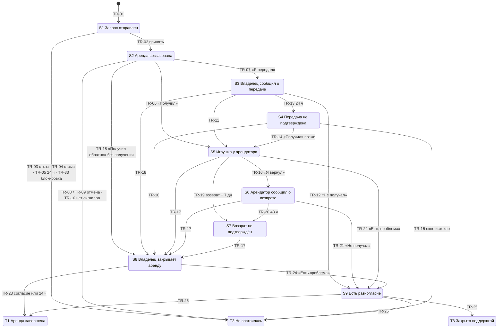

# DoRent Rental Spec v1.1

**Статус:** черновик к утверждению, ревизия 9 (19.10.2026). Открытых продуктовых и миграционных вопросов нет, все предложения подтверждены. **Не финальная и не готова к продакшену:** ADR приняты (поправки ADR-001, ADR-025, ADR-043; ADR-046…ADR-050), остаётся поправка ADR-044 (при замене страницы брони); миграция не выполнялась, код не менялся.
- B-2 утверждён 19.10.2026, вариант Б: за каждый начатый период.
- B-1 утверждён 19.10.2026, вариант А: согласие на отзывы — «Получил обратно, закрыть аренду» владельца и явное «Всё в порядке» арендатора. Молчание согласием не считается.
- Q-16 утверждён 19.10.2026, вариант A: закрытие обращения поддержкой с итогом T1 само отзывы не открывает. Нужны действия обеих сторон, у арендатора остаётся TR-32.
- Q-3…Q-12 и Q-17 утверждены 19.10.2026 (§20).
- R-3 утверждено 19.10.2026: чат аренды становится только для чтения сразу при завершении (T1), а не после отзывов (§14.1).
- M-A…M-K и Q-15: варианты выбраны ассистентом 19.10.2026 по делегированию Тиграна (документ миграции §3.2). Миграция не выполнялась.
- Q-18 и Q-20 утверждены 19.10.2026; Q-19 выбран ассистентом по делегированию Тиграна (§20).
- P-1…P-8 (все бывшие пометки [Предл.]) утверждены Тиграном 19.10.2026 (§20). В ревизии 8 Тигран изменил P-6: согласованная аренда до даты начала попадает в новую категорию F-7 «Скоро» (§15).

**Дата:** 2026-10-18, ревизии 2–9 — 2026-10-19 · **Основа:** «DoRent Rental Spec v1.0» (PDF от 18.10.2026), решения O-1…O-13 (Тигран, 18.10.2026), аудит кода на Rental-Ui@ac7fb0a и rental-api@6dcb037.
**Сопутствующие документы:** [реестр решений](rental-spec-v1.1-decisions.md) · [отчёт аудита и конфликтов](rental-spec-v1.1-audit.md) · [миграция](rental-spec-v1.1-migration.md) · [трассировка](rental-spec-v1.1-traceability.md)

**История ревизий.**

| Ревизия | Дата | Что изменилось |
|---|---|---|
| 1 | 18.10.2026 | Первая версия v1.1: O-1…O-13, R-1, R-2, аудит кода |
| 2 | 19.10.2026 | B-2 вариант Б: цена за каждый начатый период |
| 3 | 19.10.2026 | B-1 вариант А: согласие на отзывы. M-J и M-K вынесены как открытые |
| 4 | 19.10.2026 | Q-16 вариант A: отзывы после закрытия обращения |
| 5 | 19.10.2026 | Утверждены Q-3…Q-12, Q-17 и R-3 (чат только для чтения после завершения). Миграционные варианты M-A…M-K и Q-15 выбраны по делегированию. Найдены и открыты Q-18…Q-20 |
| 6 | 19.10.2026 | Утверждены Q-18 (чаты T2 и T3 тоже только для чтения) и Q-20 (поддержка может поменять итог при повторном закрытии, TR-34). Q-19 выбран по делегированию: изменение дат недоступно для перенесённых броней без снимка цены |
| 7 | 19.10.2026 | Все 8 предложений [Предл.] утверждены без изменений и получили номера P-1…P-8 (§20). Пометок [Предл.] в тексте больше нет |
| 8 | 19.10.2026 | P-6 изменён Тиграном: S2 до даты начала — в новой категории F-7 «Скоро», а не в «Идёт аренда» (§15, R-1, AC-13) |
| 9 | 19.10.2026 | S9 держит даты наравне с S2–S8: TR-01, §6 п. 4, §12 (Тигран, ADR-046). Решения «до реализации» записаны в ADR-046…ADR-050 и поправках ADR-001, ADR-025, ADR-043 |

Это продуктовая спецификация. Технические рекомендации собраны в отчёте аудита и помечены отдельно. Код, тесты, схема и настройки не менялись.

Пометки в тексте:
- **[Утв.]** — решение, утверждённое Тиграном (D-x, O-x, R-x).
- **[Предл.]** — предложение этой спецификации, которое ждёт подтверждения. С ревизии 7 таких пометок нет: все утверждены как P-1…P-8 (§20).
- **[Открыто]** — решение не принято. Раздел описывает варианты, но не выбирает.
- **[Делег.]** — вариант выбран ассистентом, которому Тигран делегировал выбор (миграция, 19.10.2026). Отдельно Тиграном не подтверждался.

---

## 0. Что изменилось относительно v1.0

| # | Изменение | Источник |
|---|---|---|
| 1 | Владелец может отменить согласованную аренду, пока не отметил передачу (S2, TR-09). После «Я передал» (S3/S4) обычной отмены нет, спор — через поддержку | O-1, Q-5 |
| 2 | Время: всё считается по Еревану (UTC+4). Напоминания в 09:00 и 18:00, тихие часы 22:00–09:00. Ключи от дублей обязательны | O-2 |
| 3 | Email только после проверки готовности. До этого только уведомления в приложении | O-3 |
| 4 | Изменение дат: одно активное предложение, 24 ч на ответ, правила конфликтов (§6) | O-4 |
| 5 | Минимальный и максимальный срок сервер проверяет при создании запроса, принятии запроса и изменении дат. Интерфейс проверяет так же | O-5, Q-3 |
| 6 | Быстрый выбор периода (1 день / 1 неделя / 1 месяц / 1 год) сохраняется. Пункт v1.0 «только за день, скрыть выбор единицы» отменён. Цена считается за каждый начатый период: день: N × цена за день; неделя: ceil(N / 7) × цена за неделю; месяц: ceil(N / 30) × цена за месяц; год: ceil(N / 365) × цена за год. Цена «за час» не предлагается для новых объявлений (§11) | O-6, B-2 |
| 7 | Даты под чужим ожидающим запросом показываются как «На рассмотрении», без имени | O-7 |
| 8 | Поддержка видит чат брони только пока обращение открыто (§9.2) | O-8 |
| 9 | Возврат без подтверждённого получения: у арендатора 24 ч на возражение, молчание означает успех (TR-18). Принцип v1.0 «успех только при двух подтверждённых встречах» смягчён | O-9 |
| 10 | Старые ссылки на брони перенаправляются в чат аренды (§16) | O-10 |
| 11 | Миграция: однозначные строки переносятся, неоднозначные не переводятся молча в итоговое состояние | O-11 |
| 12 | Блокировка посреди аренды автоматически создаёт обращение. Аккаунт остаётся заблокированным (§9.3) | O-12 |
| 13 | Оплата: DoRent её не принимает. Наличные при встрече или частная договорённость. Тексты, противоречащие этому, исправляются (§17) | O-13 |
| 14 | «Нужно ваше действие» сортируется по сроку, «Все» — по последней активности. Каждый чат ровно в одной категории (§15) | R-1 |
| 15 | Отзывы открываются только с явного согласия обеих сторон (B-1, вариант А): владелец — «Получил обратно, закрыть аренду», арендатор — «Всё в порядке». Молчание может завершить аренду (O-9), но согласием на отзывы не считается. Правило v1.0 D-6 отменено (§10) | R-2, B-1 |
| 16 | Учтены ADR-043 (дни, ночи, лимит 365, минимальный срок), ADR-044 (полоса прогресса и таймлайн) и ADR-045 (ошибки по коду) | аудит |
| 17 | Чат аренды становится только для чтения сразу при переходе в итоговое состояние (T1, T2, T3). История остаётся. Исключение — доступ поддержки, пока открыто обращение (§14.1) | R-3, Q-18 |
| 18 | Встречное предложение владельца в S1 после принятия арендатором требует подтверждения владельца. Изменение дат считается по снимку цены (§6) | Q-8, Q-9 |
| 19 | Миграция старых броней: выбраны варианты M-A…M-K и Q-15 (документ миграции §3.2) | O-11, делегирование |
| 20 | Новая категория списка чатов F-7 «Скоро»: согласованные аренды до даты начала (§15) | R-1, P-6 |

---

## 1. Модель и принципы

**«Подтверждает тот, кто получил игрушку. Молчание само ничего не подтверждает, но и не держит аренду вечно.»**

1. Передачу подтверждает арендатор («Я получил игрушку»), возврат — владелец («Получил обратно, закрыть аренду»). Вторая сторона может подтолкнуть («Я передал», «Я вернул»).
2. У каждого незавершённого состояния есть один названный участник, от которого ждут действия, и срок. Если ход не мой, интерфейс так и пишет.
3. Ни одно состояние не длится вечно, кроме открытого обращения в поддержку (его закрывает только поддержка, D-8).
4. Есть одно исключение из правила «молчание не подтверждает», и оно сознательное: владелец заявил о возврате, у арендатора было 24 ч, он промолчал. Аренда считается завершённой, даже если получение не подтверждалось (O-9, D-5).
5. Чат — рабочее место аренды. Каждое событие оставляет в чате строку с автором и временем.
6. DoRent не принимает и не гарантирует оплату, не взыскивает компенсацию и не решает, кто прав (O-13, ADR-014, ADR-018).
7. Модель «запрос на аренду». Мгновенного бронирования нет.

## 2. Термины

- **Арендатор**, **владелец** — стороны аренды. **Поддержка** — пользователь с ролью Admin, работающий с обращением.
- **Сегодня, дата, день** — календарная дата по Еревану (Asia/Yerevan, UTC+4). «Конец дня D» — 23:59:59 по Еревану в день D.
- **Дата начала, дата возврата** — `StartDate` и `EndDate` брони. Дата возврата не занята для следующей аренды, а количество дней считается как max(1, возврат − начало) (ADR-043).
- **Сигнал о передаче** — любое из: «Я получил», «Я передал», «Не получал», «Получил обратно».
- **Обращение** — сущность поддержки, привязанная к одной аренде (§9).

## 3. Состояния

| Код | Состояние | Чей ход | Арендатор видит | Владелец видит |
|---|---|---|---|---|
| S1 | Запрос отправлен | Владелец | «Ожидается ответ {владелец} · до {время}» | «Новый запрос · ответьте до {время}» + заметка |
| S2 | Аренда согласована | Никто до даты начала, затем арендатор | «Аренда согласована · встреча {дата}». С даты начала: «Подтвердите, когда получите игрушку» | «Аренда согласована · встреча {дата}». С даты начала: «Сегодня нужно передать игрушку» |
| S3 | Владелец сообщил о передаче | Арендатор | «{владелец} отметил(а) передачу. Подтвердите до {время}» | «Ждём подтверждения от {арендатор} до {время}» |
| S4 | Передача не подтверждена | Арендатор (по желанию) | «Передача не подтверждена. Если игрушка у вас, подтвердите» | «{арендатор} не подтвердил(а) получение» |
| S5 | Игрушка у арендатора | Никто до даты возврата, затем арендатор | «Игрушка у вас · вернуть до {дата}» | «Игрушка у {арендатор} · вернёт до {дата}» |
| S6 | Арендатор сообщил о возврате | Владелец | «Ждём, когда {владелец} подтвердит возврат (до {время})» | «{арендатор} отметил(а) возврат. Подтвердите до {время}» |
| S7 | Возврат не подтверждён | Владелец (по желанию) | «Возврат не подтверждён» | «Возврат не подтверждён. Если игрушка у вас, подтвердите» |
| S8 | Владелец закрывает аренду | Арендатор | «{владелец} получил(а) игрушку обратно. Аренда завершится через {N} ч» | «Аренда завершится через {N} ч, если {арендатор} не сообщит о проблеме» |
| S9 | Есть разногласие · поддержка | Поддержка | «Есть разногласие. Поддержка DoRent видит этот чат» | то же |
| T1 | Аренда завершена | — (арендатор по желанию, если отзывы ещё закрыты, TR-32) | «Аренда завершена». Отзывы открыты или «Всё было в порядке — открыть отзывы» (§10) | «Аренда завершена». Отзывы открыты или «Отзывы откроются, когда {арендатор} подтвердит, что всё было в порядке» |
| T2 | Не состоялась · {причина} | — | «Не состоялась: {причина}» | то же |
| T3 | Закрыто поддержкой | — | «Обращение закрыто поддержкой» | то же |

Причины T2: отказ владельца, запрос отозван, нет ответа за 24 ч, отменена арендатором, отменена владельцем, передачи не было, передача не подтверждена. При блокировке в S1 (TR-33) показывается причина «Запрос больше не активен».

В T1, T2 и T3 чат аренды только для чтения для обеих сторон (R-3, Q-18, §14.1). Исключение только для перенесённых данных — M-H.

Технические названия состояний (S1…T3, Pending, Active…) никогда не показываются пользователю (AC-02).

## 4. Переходы

Для любого состояния S2–S8 есть ещё переход в S9 при блокировке стороны (TR-26, §9.3). В S1 блокировка завершает запрос без обращения (TR-33, Q-7). Итог T1/T2/T3 можно поменять только при повторном закрытии переоткрытого обращения (TR-34, Q-20).

| ID | Из | Событие | Кто | Условия (guards) | В | Источник |
|---|---|---|---|---|---|---|
| TR-01 | — | Отправить запрос | Арендатор | Объявление одобрено. Не своё. Есть телефон. Не заблокирован. Даты: начало ≥ сегодня, конец ≥ начала. Дни ≥ минимального срока, дни ≤ 365. Нет пересечения ночей с S1 (живые), S2–S9 других броней **[Утв. ADR-046]**. Единица цены объявления не «час» (M-K, §11.4). Заметка ≤ 280 | S1 | ADR-043, ADR-013, базовые правила, M-K |
| TR-02 | S1 | Принять | Владелец | До истечения 24 ч. Пересечения проверяются заново, атомарно. Минимальный и максимальный срок проверяются заново по текущему минимуму объявления (Q-3). После встречного предложения владельца, принятого арендатором, это и есть подтверждение владельца (Q-9) | S2 | базовые правила, O-5, Q-3, Q-9 |
| TR-03 | S1 | Отклонить | Владелец | Причина обязательна (код или текст). Арендатору показывается текстом на его языке | T2 · отказ | базовые правила |
| TR-04 | S1 | Отозвать запрос | Арендатор | Причина необязательна (Q-4) | T2 · отозван | v1.0 |
| TR-05 | S1 | 24 ч без ответа | Система | `ExpiresAt ≤ now` | T2 · нет ответа | базовые правила |
| TR-06 | S2 | «Я получил игрушку» | Арендатор | От согласования до конца даты возврата | S5 | D-10 |
| TR-07 | S2 | «Я передал игрушку» | Владелец | От согласования до конца даты возврата | S3 | v1.0 |
| TR-08 | S2 | Отменить | Арендатор | Причина обязательна. Без штрафов. Допустимо и после даты начала, пока передача не подтверждена | T2 · отменена арендатором | v1.0 базовые правила |
| TR-09 | S2 | Отменить | Владелец | Причина обязательна. Без штрафов. Арендатор уведомляется (N-10). В S3 и S4 (после «Я передал») обычной отмены нет: спор идёт через поддержку (Q-5, §7) | T2 · отменена владельцем | O-1, Q-5 |
| TR-10 | S2 | Ни одного сигнала о передаче до конца даты возврата | Система | Нет открытого обращения | T2 · передачи не было | D-10 |
| TR-11 | S3 | «Я получил игрушку» | Арендатор | — | S5 | v1.0 |
| TR-12 | S3 | «Не получал» | Арендатор | Создаёт обращение | S9 | базовые правила |
| TR-13 | S3 | 24 ч без ответа | Система | — | S4 | базовые правила |
| TR-14 | S4 | «Я получил игрушку» (позже) | Арендатор | До конца (даты возврата + 7 дней) | S5 | D-1 |
| TR-15 | S4 | Окно истекло | Система | Нет открытого обращения | T2 · передача не подтверждена | D-1 |
| TR-16 | S5 | «Я вернул» | Арендатор | В любой момент, в том числе раньше даты возврата | S6 | базовые правила |
| TR-17 | S5, S6, S7 | «Получил обратно, закрыть аренду» | Владелец | — | S8 | D-5 |
| TR-18 | S2, S3, S4 | «Получил обратно, закрыть аренду» | Владелец | Получение не подтверждалось. Арендатор видит: «{владелец} сообщает, что игрушка возвращена. Если это не так, сообщите в течение 24 ч» | S8 (с флагом «получение не подтверждалось») | O-9 |
| TR-19 | S5 | Нет сигналов о возврате до конца (даты возврата + 7 дней) | Система | Нет открытого обращения | S7 | базовые правила |
| TR-20 | S6 | 48 ч без ответа владельца | Система | — | S7 | базовые правила |
| TR-21 | S6 | «Не получал» | Владелец | Создаёт обращение | S9 | базовые правила |
| TR-22 | S4, S5, S6, S7 | «Сообщить о проблеме» | Любая сторона | Создаёт обращение. Тип: не вернули / повреждение / другое | S9 | v1.0 |
| TR-23 | S8 | «Всё в порядке» или 24 ч без возражения | Арендатор / система | «Всё в порядке» — явное согласие арендатора на отзывы (B-1). 24 ч без возражения завершают аренду, но согласием не считаются | T1 | D-5, O-9, B-1 |
| TR-24 | S8 | «Есть проблема» | Арендатор | До истечения 24 ч. Автозавершение на паузе | S9 | D-5, O-9 |
| TR-25 | S9 | Закрыть обращение | Только поддержка | Итог: T1 (стороны согласны, что возврат был), T2 (стороны согласны, что аренды не было), T3 (согласия нет). Заметка обязательна. Итог T1 отзывы не открывает: они открыты, только если уже есть оба действия сторон (§10, Q-16 A) | T1 / T2 / T3 | D-8, D-9, Q-16 |
| TR-26 | S2–S8 | Сторона заблокирована | Система | Создаётся обращение типа «блокировка» (§9.3) | S9 | O-12 |
| TR-27 | S1, S2, S5 | Предложить другие даты | Любая сторона | Нет другого активного предложения (§6). У брони есть снимок цены и единицы: для перенесённых броней без снимка действие недоступно (Q-19) | без смены | O-4, D-7, Q-19 |
| TR-28 | — | Принять предложение | Вторая сторона | В течение 24 ч. Все проверки TR-01 по новым датам, включая минимальный и максимальный срок (Q-3). Сумма — по снимку цены и единицы (Q-8). В S1 для встречного предложения владельца даты и сумма запроса обновляются, но фиксируются только подтверждением владельца (TR-02, Q-9) | без смены, даты обновлены | O-4, Q-3, Q-8, Q-9 |
| TR-29 | — | Отклонить предложение | Вторая сторона | — | без смены | O-4 |
| TR-30 | — | 24 ч без ответа на предложение | Система | — | без смены, предложение истекло | O-4 |
| TR-31 | — | Аренда покинула S1/S2/S5 или ушла в S8/S9/T* | Система | Активное предложение аннулируется | без смены | O-4 (§6) |
| TR-32 | T1 | «Всё было в порядке — открыть отзывы» | Арендатор | Аренда завершилась без явного «Всё в порядке» арендатора (TR-23 по молчанию; TR-25 с итогом T1, Q-16 A; перенесённые брони — по M-I). Владелец уже нажал «Получил обратно, закрыть аренду». Срока нет **[Утв. P-1]**. Если владелец «Получил обратно, закрыть аренду» не нажимал, TR-32 недоступен (Q-17). Кнопка карточки работает и в чате только для чтения (R-3) | без смены, отзывы открыты | B-1, Q-16, Q-17 |
| TR-33 | S1 | Сторона заблокирована | Система | Заблокирован арендатор — запрос отозван; заблокирован владелец — запрос отклонён. Причина нейтральная: «Запрос больше не активен» (локализуется). Обращение не создаётся. Вторая сторона получает N-04 или N-03 с этой причиной | T2 · отозван / отказ | Q-7 |
| TR-34 | T1, T2, T3 | Повторно закрыть переоткрытое обращение с другим итогом | Только поддержка | Обращение переоткрыто (Q-10). Заметка с причиной смены обязательна. Отметки согласия сторон не меняются, поддержка их не выставляет (Q-16 A). Чат остаётся только для чтения (R-3, Q-18) | T1 / T2 / T3 | Q-20 |

**Общие правила переходов.**
- Каждый переход атомарен и идемпотентен. Повтор того же действия возвращает «уже сделано» и не создаёт второй строки в чате и второго уведомления (AC-16).
- Каждый переход записывает строку в чате: автор (участник, «DoRent» для системы, «Поддержка DoRent» для админа) и время.
- Пока есть открытое обращение (S9), все системные переходы и таймеры на паузе.
- Действие, которое уже не соответствует текущему состоянию (гонка), отклоняется с понятным сообщением по коду ошибки (ADR-045).

## 5. Сроки, таймеры и время

| ID | Таймер | Старт | Длительность | Действие по истечении |
|---|---|---|---|---|
| TM-01 | Ответ на запрос | TR-01 | 24 ч | TR-05 |
| TM-02 | Подтверждение передачи | TR-07 | 24 ч | TR-13 |
| TM-03 | Позднее подтверждение получения | вход в S4 | до конца (даты возврата + 7 дней) | TR-15 |
| TM-04 | Нет сигналов о передаче | вход в S2 | до конца даты возврата | TR-10 |
| TM-05 | Нет сигналов о возврате | вход в S5 | до конца (даты возврата + 7 дней) | TR-19 |
| TM-06 | Подтверждение возврата | TR-16 | 48 ч | TR-20 |
| TM-07 | Возражение на закрытие | TR-17, TR-18 | 24 ч | TR-23 |
| TM-08 | Ответ на предложение дат | TR-27 | 24 ч, но не дольше TM-01 в S1 | TR-30 |

**Правила времени.**
1. Все календарные правила (сегодня, дата начала, дата возврата, конец дня, отмена «до даты начала», «просрочено») считаются по Еревану. В Армении нет перехода на летнее время, смещение постоянно UTC+4. Хранение остаётся в UTC.
2. Часовые сроки (24 ч, 48 ч) считаются от момента события, без учёта ночи.
3. Изменение дат (TR-28) пересчитывает TM-03, TM-04 и TM-05 по новым датам.
4. Пока открыто обращение, таймеры TM-02…TM-08 стоят на паузе. После закрытия обращения аренда всегда в итоговом состоянии, поэтому возобновлять нечего. Переоткрытие обращения (Q-10) возвращает доступ поддержки, состояние аренды не меняет и таймеры не запускает. При повторном закрытии поддержка может поменять итог (TR-34, Q-20).

**Напоминания (O-2).** Плановые напоминания отправляются только в 09:00 или 18:00 по Еревану. Тихие часы — 22:00–09:00.

| ID | Напоминание | Кому | Когда | Условие |
|---|---|---|---|---|
| RM-01 | Скоро истечёт ответ на запрос | Владельцу | За 4 ч до TM-01 | S1. Срочное |
| RM-02 | Подтвердите получение | Арендатору | За 4 ч до TM-02 | S3. Срочное |
| RM-03 | Подтвердите возврат | Владельцу | За 12 ч до TM-06 | S6. Срочное |
| RM-04 | Завтра встреча | Обоим | 18:00 накануне даты начала | S2 |
| RM-05 | Встреча состоялась? | Обоим | 09:00 на следующий день после даты начала; 18:00 накануне даты возврата | S2 без сигналов |
| RM-06 | Скоро возврат | Арендатору | 18:00 накануне даты возврата | S5 |
| RM-07 | Сегодня возврат | Обоим | 09:00 в дату возврата | S5 |
| RM-08 | Срок возврата прошёл | Арендатору ежедневно; владельцу один раз | 09:00, начиная со дня после даты возврата | S5 |
| RM-09 | Возражение до… | Арендатору | За 4 ч до TM-07 | S8. Срочное |

**Срочность и тихие часы.**
- **Срочные** — уведомления с работающим сроком 48 ч и меньше: новый запрос, RM-01, RM-02, RM-03, RM-09, «владелец сообщил о передаче», «арендатор сообщил о возврате», «владелец закрывает аренду», предложение дат, обращение. Срочные отправляются сразу и в тихие часы тоже.
- **Несрочные** — все остальные. Созданные в тихие часы откладываются до 09:00.
- **[Утв. Q-6]** Несрочное уведомление, которое должно появиться с 22:00 до 09:00 по Еревану, откладывается до 09:00 во всех каналах, включая приложение: запись в приложении создаётся в 09:00. Срочные уведомления со сроком не откладываются.

**Без дублей.** У каждого уведомления и напоминания есть ключ: аренда + вид + плановый слот (дата и 09:00/18:00) или ID события. Второй раз запись с тем же ключом не создаётся.

## 6. Изменение дат (O-4, D-7)

1. Предложить новые даты может любая сторона в S1, S2 и S5 (TR-27). В S5 можно менять только дату возврата: начало уже прошло.
2. Одновременно активно только одно предложение. Пока оно активно, новые предложения не принимаются. Автор может отозвать своё предложение.
3. У второй стороны 24 ч на ответ (TM-08). Без ответа предложение истекает (TR-30), даты не меняются.
4. Принятие (TR-28) повторяет все проверки TR-01 для новых дат: начало ≥ сегодня (в S5 не проверяется), минимальный срок, максимум 365, пересечение ночей с другими бронями: живые S1, S2–S9 **[Утв. ADR-046]**.
   - Проверка при принятии выполняется атомарно. Если даты успели занять, принятие отклоняется, а предложение помечается «даты уже недоступны».
5. Новая сумма считается по правилу B-2 (§11.2) от нового количества дней. В предложении до принятия показываются старая сумма, новая сумма и разница.
   - Если новые даты переходят границу периода, сумма растёт на полный период. Пример при 7 000 ֏ за неделю: продление с 7 до 8 дней даёт +7 000 ֏.
   - **[Утв. Q-8]** При пересчёте берутся цена и единица из снимка, сохранённого при создании брони, и формула B-2. Последующие изменения цены объявления основу согласованной цены не меняют. **[Делег. Q-19]** У броней, перенесённых из старой модели, снимка нет, и задним числом он не заполняется: изменение дат для них недоступно (TR-27). Продлить перенесённую аренду можно новым запросом с даты возврата: она свободна для следующей брони (ADR-043). Текст в карточке **[Утв. P-5]**: «Для этой аренды изменить даты нельзя. Договоритесь в чате или отправьте новый запрос».
6. Конфликтующие действия:
   - S1, владелец принимает запрос при активном предложении арендатора: запрос принимается на текущих датах, предложение аннулируется (TR-31) **[Утв. P-2]**.
   - S1, владелец предлагает другие даты (встречное предложение) **[Утв. Q-9]**: если арендатор принимает, даты и сумма запроса обновляются, но аренда остаётся в S1. Владелец отдельно подтверждает запрос (TR-02 со всеми повторными проверками). Только после этого аренда переходит в S2, а даты и сумма фиксируются. Подтверждение должно успеть до TM-01, иначе запрос истекает (TR-05).
   - S1, срок предложения не может быть позже TM-01.
   - Отмена, «Я получил», TR-17/18, «Есть проблема» или любой итоговый переход аннулируют активное предложение (TR-31).
   - Если правило времени (TM-03…TM-05) срабатывает при активном предложении, оно срабатывает по действующим датам, а предложение аннулируется.
7. Даты никогда не меняются без принятия второй стороной (AC-17). Каждое предложение, ответ и истечение пишет строку в чате.

## 7. Отмена

| Кто | Когда | Причина | Последствия |
|---|---|---|---|
| Арендатор | S1 (отзыв, TR-04) | Необязательна (Q-4) | T2 · отозван, владелец уведомлён |
| Арендатор | S2 (TR-08) | Обязательна | T2 · отменена арендатором, владелец уведомлён (N-10) |
| Владелец | S1 — это отказ (TR-03) | Обязательна | T2 · отказ |
| Владелец | S2 (TR-09) | Обязательна | T2 · отменена владельцем, арендатор уведомлён (N-10) |
| Владелец | S3, S4 (после «Я передал») | — | Обычной отмены нет (Q-5). Спор — через поддержку: в S4 «Сообщить о проблеме» (TR-22). Если игрушка вернулась — «Получил обратно» (TR-18) |
| Любой | S5 и позже | — | Отмены нет. Аренда заканчивается возвратом или обращением |

Штрафов нет. Никакие тексты не упоминают возврат денег. Нынешнее правило «отменить можно только до даты начала» (`BookingsService.CancelAsync`) заменяется: для арендатора — «пока аренда в S2», для владельца — «пока аренда в S2», то есть до подтверждённой передачи и до его отметки «Я передал» (O-1 с уточнением Q-5).

Замечание к Q-5: в S3 у владельца нет действия для обращения в поддержку — TR-22 доступен с S4, куда аренда переходит через 24 ч (TM-02). Арендатор в S3 может «Не получал» (TR-12). Новое действие этой ревизией не добавляется.

## 8. Передача, возврат и противоречия

- Получение подтверждает только арендатор (TR-06, TR-11, TR-14). «Я передал» (TR-07) только просит подтвердить.
- Возврат подтверждает владелец (TR-17). «Я вернул» (TR-16) только просит подтвердить.
- **Противоречие** — это когда одна сторона заявляет событие, а вторая явно его отрицает: «Не получал» после «Я передал» (TR-12), «Не получал» после «Я вернул» (TR-21), «Есть проблема» в окне закрытия (TR-24).
  - Противоречие сразу создаёт обращение (S9).
  - Обе версии сохраняются с автором и временем.
  - Автопереходы на паузе.
  - Истечение срока не считается противоречием.
- **O-9.** Если получение не подтверждалось (S2, S3, S4), а владелец сообщает о возврате (TR-18), у арендатора 24 ч:
  - «Всё в порядке» или молчание → T1, аренда успешно завершена.
  - «Есть проблема» → S9, автозавершение на паузе.
  - В истории аренды остаётся пометка «получение не подтверждалось».
- «Получил» и «Получил обратно» не означают, что игрушка цела. Повреждение — это отдельное «Сообщить о проблеме: повреждение». DoRent не взыскивает компенсацию (ADR-018).

## 9. Поддержка, доступ к чату, блокировка

### 9.1 Обращение

- Создаётся:
  - участником аренды через «Сообщить о проблеме» (TR-22), «Не получал» (TR-12, TR-21) или «Есть проблема» (TR-24);
  - системой при блокировке (TR-26).
  - **Создать обращение по аренде может только её участник.** Нынешние жалобы на сообщение (`ReportTargetType.Message`) не проверяют участие (`ReportsService.cs:145-152`). Для обращений по аренде это недопустимо, см. отчёт аудита A-9.
- Содержит: тип (не получил / не вернули / повреждение / блокировка / другое), заявления сторон с автором и временем, описание, до 5 фото, журнал действий поддержки.
- Закрывает только поддержка (D-8): итог T1, T2 или T3 и обязательная заметка (D-9). Закрытие обращения не доказывает, что спорное событие произошло.
- Итог T1 не означает согласия сторон на отзывы (Q-16 A, §10). Поддержка фиксирует итог аренды, но не отмечает согласие за сторону.
- **[Утв. Q-10]** Переоткрыть закрытое обращение может только поддержка, с обязательной записанной причиной. **[Утв. Q-20]** При повторном закрытии поддержка может поменять итог аренды (TR-34), с обязательной заметкой о причине.
- Очередь обращений в админке. Все админы получают уведомление о новом обращении.

### 9.2 Доступ поддержки к чату (O-8)

| Момент | Доступ поддержки |
|---|---|
| Обращения нет | Нет. Чат брони виден только сторонам (как сейчас, `ChatService.IsParticipantAsync`) |
| Обращение открыто | Полная история этого чата брони, только чтение и сообщения от имени «Поддержка DoRent». Стороны видят пометку «Поддержка видит этот чат» (AC-11) |
| Обращение закрыто | Доступ к чату прекращается сразу. Остаются данные самого обращения: заявления, фото, итог, заметка |
| Обращение переоткрыто **[Утв. Q-10]** | Доступ к чату возвращается, пока обращение снова открыто, и пропадает при повторном закрытии. Если аренда уже завершена, переоткрытие не возвращает участникам отправку сообщений (R-3) |

- Каждое открытие чата поддержкой записывается в журнал аудита: кто, когда, какое обращение. Хранится только факт доступа, без текста переписки (законная аудиторская потребность).
- Если в одной аренде несколько обращений подряд, доступ есть, пока открыто хотя бы одно.
- Когда чат только для чтения (R-3), стороны отвечают поддержке через заявления в обращении (§9.1), а не сообщениями в чате.

### 9.3 Блокировка посреди аренды (O-12)

- Если заблокирован участник аренды в состоянии S2–S8, система сразу создаёт обращение «блокировка» (TR-26), и аренда переходит в S9.
- Аккаунт остаётся заблокированным. Работа поддержки по аренде не разблокирует его и не возвращает доступ к входу.
- Что может заблокированный участник: **ничего внутри приложения.** Вход ему запрещён (`AuthService.cs:183`), и это не ослабляется. Связь с ним поддержка ведёт вне DoRent по регламенту поддержки, например через email поддержки **[Утв. Q-11]**.
- Что может вторая сторона: писать в чат. Владелец может «Получил обратно» (тогда поддержка закрывает обращение с T1). Обе стороны могут добавлять пояснения и фото.
- Поддержка закрывает обращение по D-9. Заявления заблокированного участника, переданные вне приложения, поддержка фиксирует в обращении как заявление, а не как действие от его имени.
- Второй стороне показывается нейтральная формулировка: «Аренду сопровождает поддержка DoRent». Причина блокировки не раскрывается.
- **[Утв. Q-7]** S1 (запрос ещё ждёт ответа), TR-33:
  - если администратор заблокировал арендатора, запрос автоматически отзывается;
  - если заблокирован владелец, запрос автоматически отклоняется;
  - причина в обоих случаях нейтральная: «Запрос больше не активен», на языке получателя;
  - обращение не создаётся.

## 10. Отзывы (R-2, B-1 вариант А)

**[Утв. 19.10.2026] Отзывы открываются только с явного согласия обеих сторон. Согласие выражается действиями закрытия. Отдельного действия «согласен на отзывы» для владельца нет. Молчание может завершить аренду (O-9, TR-23), но согласием не считается. Автоматического открытия после завершения нет.**

| Сторона | Что считается её согласием | Переход |
|---|---|---|
| Владелец | «Получил обратно, закрыть аренду» | TR-17, TR-18 |
| Арендатор | «Всё в порядке» в окне 24 ч | TR-23 (явное нажатие) |
| Арендатор, если окно истекло молча | «Всё было в порядке — открыть отзывы» в чате завершённой аренды | TR-32 |

- Отзывы (все три вида: об игрушке, о владельце, об арендаторе) открываются, когда есть согласие обеих сторон. Это всегда момент нажатия арендатора: владелец нажимает раньше.
- Отзыв возможен только по аренде в состоянии T1. По T2, T3, S4, S7 и открытому обращению отзывов нет никогда.
- «Есть проблема» (TR-24) — не согласие. Аренда уходит в S9.
- **[Утв. 19.10.2026, Q-16 A]** Закрытие обращения поддержкой с итогом T1 само по себе отзывы не открывает. Отзывы открываются, только если зафиксированы собственные действия обеих сторон: владелец — «Получил обратно, закрыть аренду» (TR-17/18), арендатор — «Всё в порядке» (TR-23) или позже «Всё было в порядке — открыть отзывы» (TR-32). Поддержка не может отметить согласие за сторону. Если хотя бы одного действия нет, отзывы закрыты. Арендатор может открыть их позже через TR-32, если владелец уже нажал «Получил обратно, закрыть аренду». Если владелец этого не нажимал (обращение открыто из S3–S7 до его действия), отзывы по этой аренде закрыты, TR-32 недоступен **[Утв. Q-17]**. Закрытие поддержкой не считается согласием ни одной из сторон.
- Пока арендатор не согласился, владелец видит: «Отзывы откроются, когда {арендатор} подтвердит, что всё было в порядке». Напоминаний арендатору о TR-32 нет, чтобы согласие не превращалось в давление **[Утв. P-3]**.
- Правило v1.0 D-6 («закрытие = согласие») отменено.
- **Смена итога (TR-34, Q-20) [Утв. P-4]:** отзывы возможны, только пока итог T1. Если итог меняется с T1 на T2 или T3, отзывы закрываются; уже оставленные автоматически не удаляются, их судьбу решает поддержка. Если итог меняется на T1, отзывы открываются по тем же отметкам согласия: TR-32 доступен, если есть отметка владельца (Q-17).
- Сейчас в коде отзыв оставляет любая сторона завершённой брони без согласия (`ReviewsService.cs:282`) — расхождение C-01.
- Без изменений: один отзыв каждого вида на аренду; предложение отзыва показывается один раз, пропуск запоминается.
- **Изменено R-3:** чат становится только для чтения сразу при T1, а не после отзывов о людях (§14.1). Отзывы и TR-32 работают и в чате только для чтения: это действия карточки, а не сообщения.

**Тесты отзывов (обязательный набор)**

| ID | Сценарий | Ожидается |
|---|---|---|
| TC-R-01 | Владелец «Получил обратно, закрыть аренду» → арендатор «Всё в порядке» | T1, отзывы открыты обеим сторонам, N-18 обоим |
| TC-R-02 | Владелец закрыл → 24 ч без ответа арендатора | T1, отзывы закрыты, владелец видит «Отзывы откроются, когда…» |
| TC-R-03 | TC-R-02, затем арендатор «Всё было в порядке — открыть отзывы» | Отзывы открыты обеим сторонам, N-18 обоим |
| TC-R-04 | TR-18 (получение не подтверждалось) → арендатор «Всё в порядке» | T1, отзывы открыты |
| TC-R-05 | TR-18 → 24 ч молчания | T1, отзывы закрыты до TR-32 |
| TC-R-06 | Арендатор «Есть проблема» в окне S8 | S9, отзывы закрыты |
| TC-R-07 | Владелец «Получил обратно, закрыть аренду» → арендатор «Есть проблема» (S9) → поддержка закрывает с итогом T1 | T1, отзывы закрыты, N-18 нет. Арендатору доступен TR-32, владелец видит «Отзывы откроются, когда…» |
| TC-R-08 | T2 или T3 | Отзывов нет, TR-32 недоступен |
| TC-R-09 | API отзыва вызван до согласия обеих сторон | Отклонён с кодом ошибки (ADR-045) |
| TC-R-10 | Повторное «Всё в порядке» или TR-32 | Одна запись, одно уведомление (AC-16) |
| TC-R-11 | Владелец пытается открыть отзывы без согласия арендатора | Такого действия нет; отзывы закрыты |
| TC-R-12 | TC-R-07, затем арендатор «Всё было в порядке — открыть отзывы» | Отзывы открыты обеим сторонам, N-18 обоим |
| TC-R-13 | Обращение открыто из S5 через «Сообщить о проблеме» (TR-22), владелец «Получил обратно» не нажимал → поддержка закрывает с итогом T1 | T1, отзывы закрыты, TR-32 недоступен (Q-17) |
| TC-R-14 | Поддержка пытается отметить согласие стороны или открыть отзывы при закрытии обращения | Такого действия нет; API отклоняет с кодом ошибки (ADR-045) |

## 11. Цена и период (O-5, O-6, B-2)

### 11.1 Период аренды

- **[Утв. O-6]** Быстрый выбор периода на странице запроса сохраняется:

  | Кнопка | Дней | Из этого правила |
  |---|---|---|
  | 1 день | 1 | — |
  | 1 неделя | 7 | ровно 1 неделя |
  | 1 месяц | 30 | ровно 1 месяц |
  | 1 год | 365 | ровно 1 год |

  Все кнопки отсчитывают от сегодня. Кнопки, короче минимального срока, неактивны. B-2 задаёт расчёт цены и выбор периода не убирает.
- **Оплачиваемые дни N** = max(1, дата возврата − дата начала) (ADR-043). Аренда в тот же день — N = 1. Это единственное правило подсчёта на обеих сторонах.
- **«Месяц» = 30 дней, «год» = 365 дней** для расчёта цены. Это не календарные месяцы и годы. Так же считают кнопки быстрого выбора.
- **Минимальный срок** (O-5, **[Утв. Q-3]**): сервер проверяет его при создании запроса, при принятии запроса (по текущему минимуму объявления) и при принятии изменения дат: `400 booking.below_min_rental`. Интерфейс проверяет то же и не даёт отправить.
- **Максимум** N = 365 (ADR-043). 366 дней и больше отклоняются (`booking.invalid_dates`) при создании, принятии и изменении дат (Q-3). Календарь должен ограничивать выбор сам: сейчас ограничивает только сервер.

### 11.2 Расчёт суммы — B-2 «за каждый начатый период» [Утв. 19.10.2026]

| Единица цены объявления | Сумма за N оплачиваемых дней |
|---|---|
| День | N × цена за день |
| Неделя | ceil(N / 7) × цена за неделю |
| Месяц | ceil(N / 30) × цена за месяц |
| Год | ceil(N / 365) × цена за год |
| Час | Недоступна для новых объявлений (§11.4) |

- Начатый период оплачивается полностью.
- Сумма — целое число драмов. Округление не нужно: число периодов целое, а цена объявления в драмах (ADR-019).
- При максимуме N = 365 цена за год всегда даёт ровно 1 период, цена за месяц — не больше 13, цена за неделю — не больше 53.
- **Источник истины — сервер.** Интерфейс считает ту же формулу для предпросмотра. Если суммы не совпали, бронь создаётся с серверной суммой, и именно её интерфейс показывает после отправки (AC-29).
- Сумма записывается в бронь при создании и потом меняется только принятым изменением дат (§6). Она не пересчитывается при раннем или позднем возврате, при ранней или поздней передаче и при изменении цены объявления. Вместе с суммой при создании записывается снимок цены и единицы объявления; по нему считаются изменения дат (Q-8).

**Примеры.** Цены условные: 1 000 ֏ в день, 7 000 ֏ в неделю, 25 000 ֏ в месяц, 200 000 ֏ в год.

| N дней | День | Неделя | Месяц | Год |
|---|---|---|---|---|
| 1 | 1 000 | 7 000 | 25 000 | 200 000 |
| 7 | 7 000 | 7 000 | 25 000 | 200 000 |
| 8 | 8 000 | 14 000 | 25 000 | 200 000 |
| 14 | 14 000 | 14 000 | 25 000 | 200 000 |
| 15 | 15 000 | 21 000 | 25 000 | 200 000 |
| 21 | 21 000 | 21 000 | 25 000 | 200 000 |
| 31 | 31 000 | 35 000 | 50 000 | 200 000 |
| 365 | 365 000 | 371 000 | 325 000 | 200 000 |

### 11.3 Как показывать цену

| Место | Что показывается |
|---|---|
| Объявление (карточка, страница игрушки, попап на карте, страница владельца) | Цена и её единица: «7 000 ֏ / неделя». Сейчас везде, кроме попапа, жёстко «за день» (A-11) |
| Страница запроса, расчёт суммы | «N дней → K недель × 7 000 ֏ = сумма». Если N не кратно периоду, подсказка: «Оплачивается полная неделя. За ту же сумму можно вернуть до {дата}» |
| Предложение других дат | Старая сумма → новая сумма, разница (§6) |
| Карточка аренды в чате, уведомления | Сумма из брони. Строка в уведомлении «N дней · сумма» (`NotificationEmitter.BuildMeta`, ADR-019) |

Форматирование только через `DramCurrencyPipe` (ADR-019). Ни один текст не обещает оплату через DoRent (O-13).

### 11.4 Цена за час

- **[Утв. B-2]** Пока аренда считается днями, единица «час» не предлагается для новых объявлений: её нельзя выбрать ни при создании, ни при смене единицы в форме редактирования, и сервер её не принимает.
- Сейчас «час» доступен везде: в форме (`create-listing.model.ts`, `PRICE_UNITS`), а сервер принимает его при создании и изменении (`CreateListingRequest.cs:24`, `UpdateListingRequest.cs:21`). Это расхождение A-11.
- Объявления, у которых уже стоит «час»:
  - существующие брони по ним не пересчитываются;
  - **[Делег. M-K]** объявление остаётся опубликованным, но новые запросы по нему недоступны (TR-01); на странице «Владелец обновляет цену»; при редактировании «час» выбрать нельзя; владелец получает просьбу выбрать день, неделю, месяц или год;
  - ожидающие запросы (S1) по ним владелец может принять или отклонить с той суммой, которую видел арендатор (документ миграции §3.2).

### 11.5 Существующие брони

- Суммы согласованных броней (S2–S8 и итоговые) никогда не пересчитываются автоматически, ни по B-2, ни по другим правилам. Так же было при ADR-043 §4.
- **[Делег. M-J]** Ожидающие запросы (S1) по ценам за неделю, месяц или год, посчитанные старой формулой, при переходе один раз пересчитываются по B-2. В чат пишется старая и новая сумма, арендатор получает уведомление. Сумма может только уменьшиться.
- **[Делег. Q-15]** Уже согласованные до B-2 брони по ценам не за день сохраняют сумму. Поддержка получает их список, пользователям автоматически ничего не сообщается.

### 11.6 Тесты расчёта (обязательный набор)

Одна и та же таблица прогоняется на сервере (модульные и API-тесты) и в интерфейсе (модульные тесты предпросмотра). Цены как в примерах §11.2.

| ID | N | День | Неделя | Месяц | Год | Что проверяем |
|---|---|---|---|---|---|---|
| TC-P-01 | 1 (тот же день) | 1 000 | 7 000 | 25 000 | 200 000 | Аренда в тот же день = 1 день |
| TC-P-02 | 6 | 6 000 | 7 000 | 25 000 | 200 000 | За день до границы недели |
| TC-P-03 | 7 | 7 000 | 7 000 | 25 000 | 200 000 | Ровно неделя |
| TC-P-04 | 8 | 8 000 | 14 000 | 25 000 | 200 000 | День после границы недели |
| TC-P-05 | 14 | 14 000 | 14 000 | 25 000 | 200 000 | Ровно 2 недели |
| TC-P-06 | 15 | 15 000 | 21 000 | 25 000 | 200 000 | Начата 3-я неделя |
| TC-P-07 | 29 | 29 000 | 35 000 | 25 000 | 200 000 | За день до границы месяца |
| TC-P-08 | 30 | 30 000 | 35 000 | 25 000 | 200 000 | Ровно месяц |
| TC-P-09 | 31 | 31 000 | 35 000 | 50 000 | 200 000 | День после границы месяца |
| TC-P-10 | 364 | 364 000 | 364 000 | 325 000 | 200 000 | За день до границы года; ровно 52 недели |
| TC-P-11 | 365 | 365 000 | 371 000 | 325 000 | 200 000 | Ровно год = максимум |
| TC-P-12 | 366 | отклонено | отклонено | отклонено | отклонено | Сверх максимума: `booking.invalid_dates`, в интерфейсе выбрать нельзя |
| TC-P-13 | 3 при минимуме 7 | отклонено | отклонено | отклонено | отклонено | `booking.below_min_rental` (O-5) |
| TC-P-14 | 7 при минимуме 7 | 7 000 | 7 000 | 25 000 | 200 000 | Ровно минимум |
| TC-P-15 | Кнопки быстрого выбора 1/7/30/365 | 1 000 / 7 000 / 30 000 / 365 000 | 7 000 / 7 000 / 35 000 / 371 000 | 25 000 / 25 000 / 25 000 / 325 000 | 200 000 для всех | Кнопки дают те же суммы, что и календарь |
| TC-P-16 | Изменение дат 7 → 8, неделя | — | 7 000 → 14 000, +7 000 | — | — | Пересечение границы при изменении дат |
| TC-P-17 | Изменение дат 31 → 30, месяц | — | — | 50 000 → 25 000, −25 000 | — | Сокращение через границу |
| TC-P-18 | Изменение дат 8 → 13, неделя | — | 14 000 → 14 000, 0 | — | — | Внутри периода сумма не меняется |
| TC-P-19 | Любая строка выше | | | | | Предпросмотр в интерфейсе = `TotalPrice` из ответа сервера |
| TC-P-20 | Владелец меняет цену после согласования | | | | | `TotalPrice` брони не меняется |
| TC-P-21 | Создание или изменение объявления с единицей «час» | | | | | Отклонено, в форме недоступно |
| TC-P-22 | Время 00:30 по Еревану, начало «сегодня» | | | | | N и сумма одинаковы на сервере и в интерфейсе (AC-25) |
| TC-P-23 | Бронь на 7 дней по 7 000 ֏ за неделю; владелец меняет цену на 10 000; принято изменение дат 7 → 8 | — | 7 000 → 14 000, +7 000 | — | — | Пересчёт по снимку, не по текущей цене (Q-8) |
| TC-P-24 | Запрос по старому объявлению с единицей «час» | | | | | TR-01 отклонён с кодом ошибки, в интерфейсе «Владелец обновляет цену» (M-K) |
| TC-P-25 | Владелец поднял минимум с 3 до 7 при живом запросе на 3 дня, затем принимает | | | | | Принятие отклонено `booking.below_min_rental` (Q-3) |
| TC-P-26 | Перенесённая бронь без снимка цены, попытка предложить другие даты | | | | | Отклонено с кодом ошибки (ADR-045), в интерфейсе действие недоступно (Q-19) |

## 12. Доступность (O-7)

- Календарь на странице запроса показывает три вида дней:
  - занятые: S2–S9 других броней (S9 держит даты, пока обращение открыто, ADR-046);
  - «На рассмотрении»: живые S1 других пользователей;
  - свободные.
- Собственный ожидающий запрос пользователя показывается как «Ваш запрос».
- Ночи считаются по ADR-043: дата возврата чужой брони свободна для начала новой.
- Даты «На рассмотрении» нельзя выбрать, сервер их тоже отклоняет (сейчас блокирует, `BookingsStore.cs:34-68`).
- Ни имя, ни любые другие данные автора чужого запроса не раскрываются. Ответ API для календаря содержит только диапазоны дат и вид.
- Когда чужой запрос истекает, отклоняется или отзывается, его даты освобождаются.
- Если чужой запрос принят, его даты становятся занятыми. Остальные пересекающиеся запросы при нормальной работе существовать не могут (проверка при создании).

## 13. Уведомления

Все уведомления приходят на языке профиля получателя (D-4, `User.PreferredLanguage`) и ведут в чат аренды (§16). Канал: в приложении. Email только после проверки готовности (O-3, отчёт аудита A-7).

| ID | Событие | Кому | Когда | Срочное | Email после готовности |
|---|---|---|---|---|---|
| N-01 | Новый запрос (+ заметка) | Владельцу | TR-01 | Да | Да |
| N-02 | Запрос принят | Арендатору | TR-02 | Нет | Да |
| N-03 | Запрос отклонён (причина текстом) | Арендатору | TR-03, TR-33 (блокировка владельца) | Нет | Нет |
| N-04 | Запрос отозван | Владельцу | TR-04, TR-33 (блокировка арендатора) | Нет | Нет |
| N-05 | Запрос истёк | Обоим | TR-05 | Нет | Нет |
| N-06 | Предложение других дат | Второй стороне | TR-27 | Да | Нет |
| N-07 | Предложение принято / отклонено / истекло | Автору | TR-28/29/30 | Да, если владельцу нужно подтвердить запрос в S1 (Q-9); иначе нет | Нет |
| N-08 | Владелец сообщил о передаче | Арендатору | TR-07 | Да | Нет |
| N-09 | Получение подтверждено / передача не подтверждена | Владельцу / обоим | TR-06, TR-11, TR-14 / TR-13 | Нет | Нет |
| N-10 | Аренда отменена (причина) | Второй стороне | TR-08, TR-09 | Да, если встреча в ближайшие 24 ч | Да |
| N-11 | Арендатор сообщил о возврате | Владельцу | TR-16 | Да | Нет |
| N-12 | Возврат не подтверждён | Обоим | TR-19, TR-20 | Нет | Нет |
| N-13 | Владелец закрывает аренду, 24 ч на возражение | Арендатору | TR-17, TR-18 | Да | Нет |
| N-14 | Аренда завершена | Обоим | TR-23 | Нет | Нет |
| N-15 | Аренда не состоялась (передачи не было / не подтверждена) | Обоим | TR-10, TR-15 | Нет | Нет |
| N-16 | Обращение создано | Обоим + всем админам | TR-12/21/22/24/26 | Да | Да (админам) |
| N-17 | Поддержка ответила / обращение закрыто (итог) | Обоим | действия поддержки, TR-25 | Да / Нет | Нет |
| N-18 | Можно оставить отзыв | Обоим | Когда появилось согласие обеих сторон: TR-23 (явное «Всё в порядке»), TR-32. TR-25 само по себе N-18 не отправляет (Q-16 A) | Нет | Нет |
| N-19 | Район выдачи изменён (уже есть, `PickupAreaChangedAsync`) | Арендатору | смена домашней точки | Нет | Нет |
| RM-01…RM-09 | Напоминания §5 | см. §5 | см. §5 | см. §5 | Нет |

Тихие часы (§5, Q-6) действуют для всех несрочных уведомлений этой таблицы во всех каналах. Уведомления при миграции — только выбранные в документе миграции (M-J — арендатору, M-K — владельцу).

Ни одно уведомление не обещает оплату, удержание денег, возврат денег или решение спора (AC-14).

## 14. Чат аренды

- **Карточка над перепиской:** игрушка (фото, название), «{дата начала} → вернуть до {дата возврата}», сумма, одна фраза состояния (§3), плашка хода:
  - «Ваш ход · {срок}» — оранжевая;
  - «От вас сейчас ничего не нужно. Ждём {имя}» — серая;
  - «Есть разногласие» — красная.
- Кнопки: одна главная, максимум одна вторичная. Остальное в меню «⋯»: другие даты, отменить, сообщить о проблеме, подробности (заметка, компенсация, район).
- Телефон, 390px: карточка закреплена сверху и сворачивается при прокрутке. Кнопки не перекрываются нижней навигацией (M-043).
- Десктоп, 1280px: три колонки — список, переписка, карточка.
- **Системные строки:** на каждое событие, с автором и временем, на языке читателя. Строки появляются и для отказа, отмены, истечения, таймеров, предложений дат, действий поддержки. Сейчас строк нет у отказа, отмены и истечения, а автор не хранится (`ConversationsStore.cs:348`).
- **ADR-044 и карточка [Утв. Q-12]:** когда чат аренды заменит страницу брони, отдельные полоса прогресса и таймлайн ADR-044 заменяются карточкой аренды в чате и системными строками. Пока старая страница брони существует, ADR-044 действует для неё. Поправка ADR-044 вносится при реализации (Rule 0).
- Модерационные треды карточки аренды не имеют.

### 14.1 Чат после итогового состояния (R-3, Q-18) [Утв. 19.10.2026]

- Когда аренда переходит в T1 (TR-23 или TR-25 с итогом T1), чат сразу становится только для чтения для обеих сторон. Отзывов для этого ждать не нужно.
- История сообщений и системных строк остаётся доступной для чтения.
- Участники не могут отправлять новые сообщения. Попытка через API отклоняется с кодом ошибки (ADR-045).
- Действия карточки в чате только для чтения остаются: отзывы (§10) и TR-32. Это не сообщения.
- **Исключение — поддержка.** Пока по аренде открыто обращение, поддержка имеет доступ к чату (§9.2). Переоткрытие обращения (Q-10) возвращает доступ поддержки, но не возвращает участникам возможность писать. Стороны отвечают через заявления в обращении (§9.1).
- Заблокированный участник не входит в приложение (§9.3); правило «только для чтения» на это не влияет.
- **Не входит в эту версию:** блокировка одного пользователя другим.
- **Старые итоговые брони:** чаты старых Rejected, Cancelled и Expired остаются открытыми (M-H — исключение только для перенесённых данных, документ миграции §3.2). На новые аренды оно не распространяется. Чаты остальных перенесённых итоговых броней — T1 (MG-04, M-A) и T2 из MG-02 и M-E — становятся только для чтения при миграции.
- **[Утв. Q-18] T2 и T3:** чаты не состоявшихся и закрытых поддержкой аренд тоже становятся только для чтения сразу при переходе в итоговое состояние, по тем же правилам. Это касается и T2 из S1 (отказ, отзыв, истечение, TR-33). Смена итога (TR-34) отправку участникам не возвращает.
- **ADR-001 сейчас говорит обратное:** блокировка чата — «аренда завершена И оба отзыва есть», а состояние плашки `completed` означает «аренда завершена, чат открыт, ждём отзывы» (поправка от 11.07.2026). R-3 требует поправки ADR-001 до реализации (Rule 0, конфликт C-25). В этой ревизии ADR не менялся.
- Сейчас в коде чат закрывается только после обоих отзывов о людях (`ReviewsService.cs:323-337`, `ChatService.TryLazyCloseAsync`).

## 15. Список чатов (R-1, D-2, D-11)

| ID | Категория | Состав (для текущего пользователя) | Порядок |
|---|---|---|---|
| F-0 | Все | Все чаты, включая модерационные | По последней активности (сообщение или событие) |
| F-1 | Есть проблема | S9 | По последней активности |
| F-2 | Нужно ваше действие | Ход за мной: владелец в S1, S6, S7; арендатор в S2 с даты начала, S3, S4, S8; арендатор в S5 с даты возврата; получатель активного предложения дат | По сроку (ближайший первым), затем по активности |
| F-3 | Ждём ответа | Ход за второй стороной | По последней активности |
| F-7 | Скоро | S2 до даты начала: аренда согласована, ни у кого нет хода **[Утв. P-6, ревизия 8]**. С даты начала аренда уходит в F-2 (арендатор) или F-3 (владелец) | По последней активности |
| F-4 | Идёт аренда | S5 до даты возврата, когда ни у кого нет хода | По последней активности |
| F-5 | Завершённые | T1 | По последней активности |
| F-6 | Не состоялись | T2, T3, S4 после истечения окна (то есть T2), S7. В строке подписана причина | По последней активности |

- **Ровно одна категория.** F-1…F-7 не пересекаются, «Все» (F-0) — их объединение плюс модерационные треды. При пересечении действует приоритет: F-1 → F-2 → F-3 → F-7 → F-4 → F-5 → F-6. Номер F-7 добавлен в ревизии 8, чтобы не перенумеровывать остальные категории.
- Срок у пунктов F-2 без часового срока — конец соответствующего дня по Еревану (например, конец даты возврата).
- Категория вычисляется по состоянию и роли и не хранится отдельно. Счётчики категорий и текст карточки берутся из одного вычисления (AC-13).
- Непрочитанные не меняют категорию. Категория не влияет на уведомления.
- Где модерационные треды, кроме «Все»: **[Утв. P-7]** только во «Все».

## 16. Старые ссылки (O-10)

| Старый адрес | Новое поведение |
|---|---|
| `/bookings/:bookingId` (уведомления «Approved», «Pickup») | Найти или создать чат брони (`from-booking`) и перейти в `/chat/:conversationId`, заменив адрес в истории (без возврата назад в цикл) |
| `/bookings/requests`, `/profile/requests` (уведомление «Request») | `/chat` с категорией F-2 «Нужно ваше действие» |
| `/bookings`, `/profile/rentals` | `/chat` с категорией F-0 «Все» |
| `/bookings/:bookingId/review`, `/bookings/:bookingId/review/renter` | Если отзывы открыты (§10) — страница отзыва. Иначе — чат аренды |
| `/listings` (уведомление «Declined») | Без изменений |
| `/listings/:id/book` | Без изменений (страница запроса) |

- **Поведение при ошибках:**

  | Случай | Ответ API | Что видит пользователь |
  |---|---|---|
  | Аренда не найдена или ID неверного формата | 404 | Страница «Аренда не найдена» со ссылкой «К сообщениям» |
  | Пользователь не участник | 403 | «Эта аренда вам недоступна» |
  | Пользователь заблокирован | `booking.user_blocked` / `chat.user_blocked` | Общее сообщение о блокировке (ADR-045) |
  | Не вошёл | — | `authGuard` запоминает адрес и возвращает к нему после входа |

- **Без циклов:**
  - Перенаправление идёт только в одну сторону, с `/bookings/*` на `/chat/*`.
  - Чат никогда не перенаправляет на `/bookings/*`. Ссылку «Открыть бронь» в шапке чата (`conversation-details-page.component.html:143`) убрать.
  - Неудачная попытка показывает страницу ошибки и сама не перенаправляет.
- Сохранённые в БД ссылки уведомлений (`Notification.PrimaryActionDeepLink`) не переписываются: они продолжают работать через перенаправление.

## 17. Оплата (O-13)

- DoRent не принимает, не хранит, не обрабатывает и не гарантирует оплату аренды. Стороны платят наличными при встрече или договариваются сами.
- Оплаты нет ни в одном состоянии, переходе, уведомлении или кнопке.
- Тексты, которые сейчас противоречат O-13 и должны быть изменены (en, такие же ключи в ru/hy):

| Ключ | Сейчас | Почему противоречит |
|---|---|---|
| `listings.details.howItWorks.step3` | «Owner confirms, then you pay» | Подразумевает оплату через платформу после подтверждения |
| `listings.bookingPage.notCharged` | «You won't be charged until {{name}} confirms.» | Подразумевает, что платформа будет списывать деньги |
| `listings.bookingPage.notChargedShort` | «You're not charged yet» | То же |
| `listings.bookingPage.heroSubtitle` | «… you're not charged yet.» | То же |
| `listings.details.protection.pillNoUpfront` | «Nothing charged upfront» | То же |
| `listings.booking.howThisWorks.point1` | «No money is taken at booking or handed over at pickup.» | **Прямо противоречит** O-13: оплата при встрече допустима |
| `listings.createForm.priceUnitLabel` / `priceUnitMenuTitle` | «Charged per» / «Charge per» | «Charged» подразумевает списание через платформу. **[Утв. P-8]** «Цена за» (en «Price per», hy — при переводе) |

Тексты для замены пишутся на этапе дизайна. Правило для них: «Сумма — это договорённость между вами и владельцем. DoRent не принимает оплату. Обычно платят при встрече».

## 18. Крайние случаи

| Ситуация | Ожидаемый исход |
|---|---|
| Встретились раньше или позже даты начала | «Я получил» работает от согласования до даты возврата. Даты не меняются |
| Арендатор получил игрушку, но ничего не нажал. Владелец потом получил её обратно | TR-18 → S8 → 24 ч → T1 (O-9) |
| Никто ничего не нажимал до конца даты возврата | RM-05 дважды, затем TR-10 → T2 «передачи не было» |
| Ранний возврат | «Я вернул» в любой момент. Сумма не меняется |
| Повреждение при возврате | Владелец: «Сообщить о проблеме: повреждение» (TR-22) до или вместо «Получил обратно». Арендатор: «Есть проблема» в окне S8 |
| Владелец хочет отменить после «Я передал» (S3/S4) | Обычной отмены нет (Q-5). В S4 — «Сообщить о проблеме» (TR-22) и поддержка. Если игрушка вернулась — «Получил обратно» (TR-18) |
| Предложение дат активно, срабатывает таймер | Таймер по действующим датам, предложение аннулируется (§6) |
| Две вкладки, двойное нажатие | Одна запись, одна строка, одно уведомление |
| Объявление в архиве во время аренды | Аренда продолжается. Карточка показывает данные на момент брони |
| Владелец поднял минимальный срок при живом запросе | Принятие проверяет текущий минимум и отклоняется, если запрос короче (Q-3, TC-P-25). Можно предложить другие даты (TR-27) |
| Блокировка участника в S2–S8 | §9.3 |
| Обращение открыто, наступает конец даты возврата + 7 | Ничего не происходит, таймеры на паузе |
| Пользователь в 00:30 по Еревану (UTC ещё «вчера») | Все календарные правила по Еревану (§5) |
| Цена за неделю, аренда 8 дней | 2 недели (B-2). Подсказка «за ту же сумму можно вернуть до {дата}» |
| Продление через границу периода | Сумма растёт на полный период, разница показывается в предложении (§6) |
| Ранний возврат по цене за неделю или месяц | Сумма не меняется (§11.2) |
| Владелец меняет цену или единицу при живом запросе | Сумма запроса не меняется. Пересчёт только через принятое изменение дат, по снимку (Q-8) |
| Объявление с ценой «за час», созданное до отключения | Опубликовано, новые запросы недоступны, «Владелец обновляет цену». Живые S1 принимаются или отклоняются по показанной сумме (M-K) |
| Поддержка закрыла обращение с итогом T1 | Отзывы закрыты, пока нет обоих действий сторон. Арендатор открывает их через TR-32 (Q-16 A) |
| Блокировка арендатора (§9.3), владелец «Получил обратно», поддержка закрывает с T1 | Отзывы закрыты. Заблокированный арендатор не может нажать TR-32, пока он заблокирован (O-12) |
| Поддержка закрыла с T1, владелец «Получил обратно» не нажимал | Отзывы закрыты, TR-32 недоступен (Q-17) |
| Участник пытается написать в чат после T1 | Отправка недоступна, чат только для чтения (R-3) |
| Поддержка переоткрыла обращение по завершённой аренде | Поддержка снова видит чат; участники писать не могут (Q-10, R-3) |
| Блокировка участника в S1 | Запрос отозван или отклонён с причиной «Запрос больше не активен», без обращения (TR-33, Q-7) |
| Отказ, отзыв или истечение запроса (T2 из S1) | Чат сразу только для чтения (Q-18) |
| Поддержка повторно закрывает переоткрытое обращение с другим итогом | TR-34: итог меняется, заметка обязательна, чат остаётся только для чтения (Q-20) |
| Изменить даты в перенесённой брони без снимка цены | Недоступно. Продление — новым запросом с даты возврата (Q-19) |
| Арендатор завершил аренду молчанием (TR-23) | Аренда T1, отзывы закрыты. У арендатора в чате «Всё было в порядке — открыть отзывы» (TR-32) |

## 19. Критерии приёмки

| ID | Критерий |
|---|---|
| AC-01 | На любом этапе карточка одной фразой говорит, что происходит, чей ход и что сделать. Если ход не мой, написано «От вас сейчас ничего не нужно» |
| AC-02 | Ни один пользовательский текст на трёх языках не содержит технических названий состояний |
| AC-03 | Владелец видит заметку арендатора в чате и в уведомлении о запросе |
| AC-04 | Даты под чужим живым запросом показаны как «На рассмотрении» без данных автора. Отправить запрос на них невозможно |
| AC-05 | «Я передал» не переводит аренду в S5 |
| AC-06 | T1 достижимо только через S8 (TR-23) или через закрытие поддержкой с итогом T1 (TR-25, при повторном закрытии — TR-34) |
| AC-07 | S4, S7, T2 и T3 никогда не попадают в «Завершённые» и не открывают отзывы |
| AC-08 | Каждое событие, включая таймеры, изменение дат и действия поддержки, даёт строку в чате с автором и временем и поднимает чат в «Все» |
| AC-09 | Каждое событие из §13 уведомляет адресата на языке его профиля |
| AC-10 | Ни одно состояние, кроме S9, не живёт без действия дольше своего срока из §5 |
| AC-11 | Без открытого обращения поддержка не может открыть чат брони. С открытым — может, и стороны видят пометку. После закрытия доступ сразу пропадает |
| AC-12 | S9 закрывает только поддержка, с итогом и заметкой. Пока S9 открыто, автопереходы на паузе |
| AC-13 | Каждый чат ровно в одной категории F-1…F-7. Категория совпадает с текстом карточки |
| AC-14 | Ни один текст не обещает и не подразумевает оплату через DoRent, удержание, возврат денег или решение спора платформой |
| AC-15 | На 390px главная кнопка карточки нажимается (проверка `elementFromPoint`). На 1280px карточка видна целиком |
| AC-16 | Повторное или параллельное действие не создаёт второго перехода, строки или уведомления |
| AC-17 | Даты меняются только после принятия предложения второй стороной. Одновременно не больше одного активного предложения |
| AC-18 | Владелец может отменить только в S2 и только с причиной; арендатор получает уведомление. В S3 и S4 действия отмены у владельца нет, API отклоняет с кодом ошибки (Q-5) |
| AC-19 | Плановые напоминания приходят только в 09:00 или 18:00 по Еревану. Несрочные уведомления, которые должны появиться с 22:00 до 09:00, появляются в 09:00 во всех каналах, включая приложение. Срочные со сроком не откладываются (Q-6). Одно напоминание не приходит дважды |
| AC-20 | Без подтверждённой готовности email (отчёт аудита A-7) письма по аренде не отправляются |
| AC-21 | TR-18: при заявлении владельца о возврате без подтверждённого получения через 24 ч без возражения аренда — T1. При «Есть проблема» — S9 |
| AC-22 | Блокировка участника в S2–S8 создаёт обращение. Аккаунт остаётся заблокированным. Заблокированный не может войти и действовать |
| AC-23 | Обращение по аренде может создать только её участник или система |
| AC-24 | Каждая старая ссылка из §16 ведёт в нужный чат или на понятную страницу ошибки, без циклов |
| AC-25 | Календарные правила (отмена до начала, просрочено, конец дня) дают один и тот же результат на сервере и в интерфейсе в 00:00–04:00 по Еревану |
| AC-26 | Календарь и быстрый выбор не дают выбрать больше 365 дней и меньше минимального срока. Сервер отклоняет такие сроки при создании запроса, принятии и изменении дат (Q-3) |
| AC-27 | Отзывы открываются только при наличии обоих действий: «Получил обратно, закрыть аренду» владельца (TR-17/18) и явного «Всё в порядке» (TR-23) или «Всё было в порядке» (TR-32) арендатора. Молчание отзывы не открывает. Отдельного действия согласия у владельца нет. Тесты TC-R-01…TC-R-14 проходят |
| AC-28 | Ни одна мигрированная бронь не попадает в итоговое состояние без правила из документа миграции (MG-x или выбранного варианта M-x, §3.2) |
| AC-29 | Сумма считается по B-2 (§11.2) одной формулой на сервере и в интерфейсе. Все тесты TC-P-01…TC-P-25 проходят на обеих сторонах. Предпросмотр совпадает с `TotalPrice` сервера |
| AC-30 | Цена объявления везде показывается с её единицей. Нигде не написано «за день» для цены за другой период |
| AC-31 | Единицу «час» нельзя выбрать и сохранить для объявления. Сервер отклоняет её при создании и изменении. По старым почасовым объявлениям новые запросы недоступны (M-K) |
| AC-32 | Сумма согласованной брони не меняется ни при изменении цены объявления, ни при раннем или позднем возврате. Меняется только принятым изменением дат, по снимку цены и единицы (Q-8) |
| AC-33 | Арендатор, чья аренда завершилась без его явного «Всё в порядке», видит в чате «Всё было в порядке — открыть отзывы». После нажатия отзывы открываются обеим сторонам. Напоминаний об этом нет |
| AC-34 | Закрытие обращения поддержкой с итогом T1 само по себе не открывает отзывы и не отправляет N-18. У поддержки нет действия, которое отмечает согласие за сторону. Если владелец уже нажал «Получил обратно, закрыть аренду», арендатор видит TR-32 (Q-16 A) |
| AC-35 | Блокировка участника в S1 переводит запрос в T2 (отозван — при блокировке арендатора, отказ — при блокировке владельца) с причиной «Запрос больше не активен» на языке получателя. Обращение не создаётся (Q-7, TR-33) |
| AC-36 | После перехода в T1, T2 или T3 участники не могут отправить сообщение в чат аренды, история читается. Отзывы и TR-32 доступны. Поддержка видит чат, только пока открыто обращение; переоткрытие обращения не возвращает участникам отправку (R-3, Q-18, Q-10) |
| AC-37 | Встречное предложение владельца в S1, принятое арендатором, не переводит аренду в S2. Переход в S2 и фиксация дат и суммы — только после подтверждения владельца (Q-9) |
| AC-38 | Переоткрыть обращение может только поддержка, с причиной. Доступ поддержки к чату есть, пока обращение открыто, и пропадает при повторном закрытии (Q-10). При повторном закрытии поддержка может поменять итог, заметка обязательна; отметки согласия сторон не меняются (TR-34, Q-20) |
| AC-39 | Миграция не меняет `TotalPrice` броней S2–S8 и итоговых. Меняются только суммы S1 по M-J, с записью в чате и уведомлением арендатору (M-J, M-K, Q-15) |
| AC-40 | Для перенесённой брони без снимка цены «Предложить другие даты» недоступно: в интерфейсе действия нет, API отклоняет с кодом ошибки. Новые брони всегда получают снимок (Q-19, TC-P-26) |

## 20. Решения и открытые вопросы

### Утверждено (19.10.2026)

- **B-2 — вариант Б, «за каждый начатый период»:** день: N × цена за день; неделя: ceil(N / 7) × цена за неделю; месяц: ceil(N / 30) × цена за месяц; год: ceil(N / 365) × цена за год (§11.2). Пропорциональный расчёт не применяется.
- **B-1 — вариант А:** согласие на отзывы — «Получил обратно, закрыть аренду» владельца и явное «Всё в порядке» (или позже «Всё было в порядке», TR-32) арендатора. Отдельного действия согласия для владельца нет, молчание согласием не считается (§10).
- **Q-16 — вариант A:** Закрытие обращения поддержкой с итогом T1 само по себе отзывы не открывает. Отзывы открываются, только если зафиксированы собственные действия обеих сторон: владелец — «Получил обратно, закрыть аренду» (TR-17/18), арендатор — «Всё в порядке» (TR-23) или позже «Всё было в порядке — открыть отзывы» (TR-32). Поддержка не может отметить согласие за сторону. Если хотя бы одного действия нет, отзывы закрыты; арендатор может открыть их позже через TR-32 (§10, TR-25, TC-R-07, AC-34). Отклонены: Б (закрытие поддержкой открывает отзывы — согласие дала бы поддержка, а не стороны) и В (после обращения отзывов нет никогда).

### Утверждено 19.10.2026 — продуктовые вопросы

| ID | Решение | Где отражено |
|---|---|---|
| Q-3 | Сервер проверяет минимальный и максимальный срок при создании запроса, принятии запроса и изменении дат. Интерфейс проверяет так же | TR-02, TR-28, §11.1, AC-26, TC-P-25 |
| Q-4 | Причина отзыва запроса в S1 необязательна | TR-04, §7 |
| Q-5 | После «Я передал» (S3/S4) обычной отмены владельцем нет. Спор — через поддержку DoRent | TR-09, §7, §18, AC-18 |
| Q-6 | Несрочные уведомления, приходящиеся на 22:00–09:00 по Еревану, откладываются до 09:00 во всех каналах, включая приложение. Срочные уведомления со сроком не откладываются | §5, §13, AC-19 |
| Q-7 | Блокировка в S1: арендатор заблокирован — запрос отозван, владелец — запрос отклонён. Причина «Запрос больше не активен» (локализуется). Обращение не создаётся | TR-33, §9.3, AC-35 |
| Q-8 | Изменение дат считается по снимку цены и единицы, сохранённому при создании брони, по формуле B-2. Последующие изменения цены объявления основу не меняют | §6, §11.2, AC-32, TC-P-23 |
| Q-9 | Встречное предложение владельца в S1, принятое арендатором, требует отдельного подтверждения владельца. Только после него аренда переходит в S2, а даты и сумма фиксируются | §6, TR-02, TR-28, AC-37 |
| Q-10 | Поддержка может переоткрыть закрытое обращение с записанной причиной. Доступ к чату возвращается, пока обращение открыто, и пропадает при повторном закрытии | §9.1, §9.2, AC-38 |
| Q-11 | Связь с заблокированным участником — вне DoRent по регламенту поддержки (например, email поддержки). Поддержка записывает его заявления, но не действует от его имени. Причина блокировки второй стороне не раскрывается, формулировка нейтральная | §9.3 |
| Q-12 | Когда чат аренды заменит страницу брони, отдельные полоса прогресса и таймлайн ADR-044 заменяются карточкой аренды в чате. Пока старая страница существует, ADR-044 действует для неё | §14 |
| Q-17 | Обращение закрыто с итогом T1, а владелец «Получил обратно, закрыть аренду» не нажимал: отзывы закрыты, TR-32 недоступен. Закрытие поддержкой не считается согласием ни одной из сторон | §10, TR-32, TC-R-13 |
| Q-18 | Чаты новых аренд в T2 (не состоялась) и T3 (закрыто поддержкой) тоже становятся только для чтения сразу при переходе в итоговое состояние, по правилам R-3. Исключение M-H — только для перенесённых данных | §3, §14.1, AC-36 |
| Q-20 | При повторном закрытии переоткрытого обращения поддержка может поменять итог аренды (T1/T2/T3), с обязательной заметкой о причине | TR-34, §9.1, AC-06, AC-38 |
| R-3 | Чат аренды становится только для чтения сразу при завершении (T1), а не после отзывов. История сохраняется. Исключение — доступ поддержки, пока открыто обращение; переоткрытие обращения не возвращает участникам отправку сообщений. Блокировки одного пользователя другим нет | §14.1, §10, AC-36 |

### Выбрано по делегированию (миграция и Q-19, 19.10.2026)

Тигран делегировал ассистенту выбор вариантов миграции и Q-19. Варианты ниже выбраны в ревизии 5 и отдельно Тиграном не подтверждались. Последствия и уведомления — документ миграции §3.2. Миграция не выполнялась: перед продакшеном её прогоняют на копии БД, а код миграции проверяет человек.

| ID | Выбор | Кратко |
|---|---|---|
| M-A | (1) | Completed с `ActiveAt = null` → T1 с пометкой миграции. Оставленные отзывы сохраняются |
| M-B | (1) | ReturnMarked (6) → S7 без уведомлений. Владелец может подтвердить возврат. Список — поддержке |
| M-C | (1) | Старое Active = подтверждённое получение (S5) |
| M-D | (1) | Active с `EndDate + 7 < today` → сразу S7, без нового окна и уведомлений |
| M-E | (1) | Approved с `EndDate < today` → сразу T2 «передачи не было» |
| M-F | (1) | S2–S8 с заблокированной стороной → обращение «блокировка» |
| M-G | (1) | Чаты для S1–S8 при миграции, для итоговых — при первом переходе по `from-booking` |
| M-H | (1) | Чаты старых Rejected, Cancelled, Expired остаются открытыми. Исключение только для перенесённых данных |
| M-I | (1) | Старое завершение владельцем = его согласие на отзывы, арендатор — через TR-32. Для M-A отзывы закрыты. Оставленные отзывы сохраняются |
| M-J | (1) | S1 по неделе, месяцу, году пересчитываются по B-2 при переходе: строка в чате со старой и новой суммой, уведомление арендатору |
| M-K | (1) + (а) | Почасовые объявления опубликованы, но без новых запросов («Владелец обновляет цену»), «час» нельзя выбрать при редактировании. Живые S1 — по показанной сумме |
| Q-15 | (А) | Согласованные до B-2 брони по ценам не за день сохраняют сумму. Поддержка получает список, пользователям автоматически ничего не сообщается |
| Q-19 | Изменение дат недоступно | Перенесённые брони без снимка цены: «Предложить другие даты» (TR-27) недоступно, снимок задним числом не заполняется. Новые брони получают снимок всегда. Разбор — миграция §3.2 |

### Подтверждённые предложения P-1…P-8 (ревизия 7)

Открытых продуктовых и миграционных вопросов нет. Все 8 предложений этой спецификации (бывшие пометки [Предл.]) Тигран утвердил 19.10.2026 (карточка RL-01); P-6 изменён в ревизии 8. Отклонённые альтернативы записаны в реестре решений.

| ID | Где | Утверждённое правило |
|---|---|---|
| P-1 | TR-32 | У «Всё было в порядке — открыть отзывы» нет срока |
| P-2 | §6 п. 6 | Владелец принимает запрос при активном предложении арендатора: запрос принимается на текущих датах, предложение аннулируется (TR-31) |
| P-3 | §10 | Напоминаний арендатору о TR-32 нет |
| P-4 | §10, TR-34 | Последствия смены итога для отзывов (Q-20): отзывы возможны только при итоге T1; уже оставленные при смене итога автоматически не удаляются, решает поддержка; при возврате к T1 отзывы открываются по тем же отметкам согласия |
| P-5 | §6, Q-19 | Текст в карточке, когда изменение дат недоступно: «Для этой аренды изменить даты нельзя. Договоритесь в чате или отправьте новый запрос» |
| P-6 | §15, F-7 | S2 до даты начала попадает в отдельную категорию F-7 «Скоро» (изменено в ревизии 8; в ревизии 7 было «Идёт аренда») |
| P-7 | §15 | Модерационные треды — только во «Все» |
| P-8 | §17 | «Charged per» / «Charge per» заменить на «Цена за» (en «Price per») |

### Обязательно до реализации (Rule 0)

- ~~Поправка ADR-001~~ — принята 19.10.2026 (R-3, C-25).
- ~~Поправка ADR-043 §3~~ — принята 19.10.2026 (Q-3).
- Поправка ADR-044 при замене страницы брони (Q-12).
- ~~Пересмотр ADR-025~~ — поправка принята 19.10.2026 (D-4).
- ~~Новый ADR о цене~~ — ADR-047, 19.10.2026 (B-2, Q-8, M-K). Модель состояний — ADR-046, время и таймеры — ADR-048, обращения — ADR-049, согласие на отзывы — ADR-050.

Q-13 (неоднозначные строки миграции) закрыт выбором M-A…M-K.
